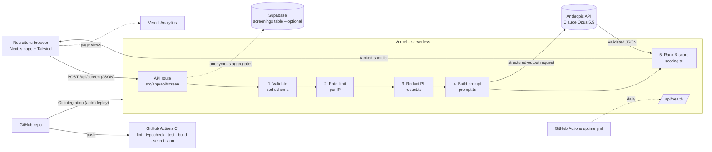

# Architecture Notes – ShortlistAI

## System overview

## Layers

| Layer | Technology | Responsibility | Key files |
|---|---|---|---|
| **UI** | Next.js 14 App Router (React 18, client components), Tailwind CSS | Form input, client-side validation, results matrix, evidence cards, CSV export | `src/app/page.tsx`, `src/components/ScreenForm.tsx`, `src/components/Results.tsx` |
| **Backend** | Next.js Route Handlers (Node.js runtime on Vercel Functions) | Validation, rate limiting, orchestration, error mapping | `src/app/api/screen/route.ts`, `src/app/api/health/route.ts` |
| **Domain logic** | Plain TypeScript (pure functions, unit-tested) | PII redaction, prompt building, scoring and ranking, CSV | `src/lib/redact.ts`, `src/lib/prompt.ts`, `src/lib/scoring.ts` |
| **AI layer** | `@anthropic-ai/sdk` → Claude `claude-opus-5-5`, structured outputs via zod | Requirement extraction, evidence classification, summaries, interview questions | `src/lib/screen.ts`, `src/lib/schema.ts` |
| **Data / analytics** | Supabase Postgres (optional), Vercel Analytics, structured `console.log` → Vercel Logs | Anonymous usage metrics and monitoring. **No resume storage.** | `src/lib/usageLog.ts`, `supabase/schema.sql` |
| **CI/CD** | GitHub Actions + Vercel Git integration | Quality gate on every push; auto-deploy of `main` to production, with preview deploys for PRs | `.github/workflows/ci.yml`, `.github/workflows/uptime.yml` |

## Request data flow
1. The browser validates the form with the same zod schema the server uses, for instant feedback.
2. `POST /api/screen` → server re-validates (never trust the client) → per-IP rate limit.
3. `redactPII()` runs on each resume, and candidates become `C1…Cn`.
4. A single Claude call (`client.beta.messages.parse` with `output_config.format = betaZodOutputFormat(AIScreeningSchema)`) returns schema-valid JSON.
5. `rankCandidates()` joins the AI output with the original labels, computes the scores and recommendations, and sorts.
6. The response goes to the browser. An anonymous usage event is logged to Vercel Logs and, optionally, to Supabase.

## Key design decisions
| Decision | Why |
|---|---|
| **One AI call per screening** (not one per candidate) | The AI sees all candidates against the *same* extracted requirements, which keeps the comparison consistent. It is also cheaper and faster. |
| **Structured outputs + zod** | Guarantees parseable JSON. The same schema is used for TypeScript types, the UI and tests. |
| **Scores in code, not in the AI** | Explainable, repeatable and testable (spec revision 1.1). |
| **Redact before the AI** | Reduces bias and limits personal data shared with a processor (RA 10173). |
| **Official Anthropic SDK instead of the Vercel AI SDK** | The course recommends the Vercel AI SDK. This module needs no streaming chat UI, and the official SDK has first-class structured outputs, typed errors and refusal fallbacks. The rest of the recommended stack (Next.js 14, Tailwind, Vercel, GitHub Actions, Supabase) is used as suggested. |
| **No auth in v1** | Graders and testers must be able to use the live URL in incognito with no sign-up. The rate limit and input caps protect cost. Auth (Supabase Auth) is a v2 item. |
| **Demo mode** | CI, local development without a key, and a graceful fallback that is clearly labelled in the UI. |

## Security and secrets
- `ANTHROPIC_API_KEY` and `SUPABASE_SERVICE_ROLE_KEY` exist only as **Vercel environment variables** and in a local `.env.local`, which is git-ignored. `.env.example` documents the variable names with empty values.
- `scripts/check-secrets.sh` runs in CI and fails the build if a key-like string or a `.env` file is committed.
- The API key is used only server-side (in the route handler). It is never sent to the browser and never logged.
- Supabase table has Row Level Security enabled, and only the service role can insert.

## Monitoring
- **Vercel Analytics:** page views and visitors.
- **Vercel Logs:** one JSON line per screening (`type: "screening"`, success, duration, model, candidate count), plus errors.
- **`/api/health` + `uptime.yml`:** daily automated health check from GitHub Actions.
- **Supabase `screenings` table (optional):** usage history for metrics such as screenings per day and the error rate.
